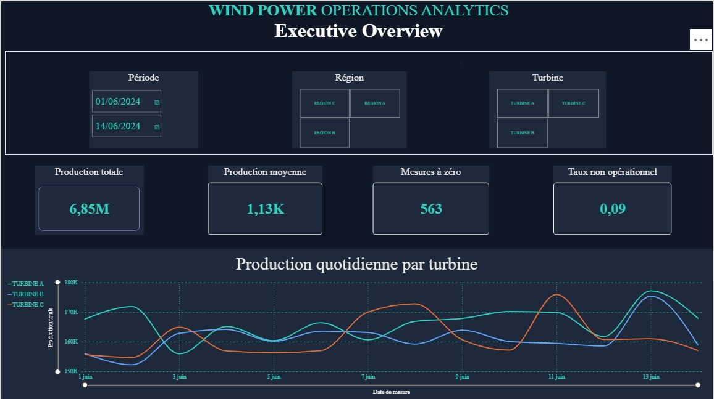
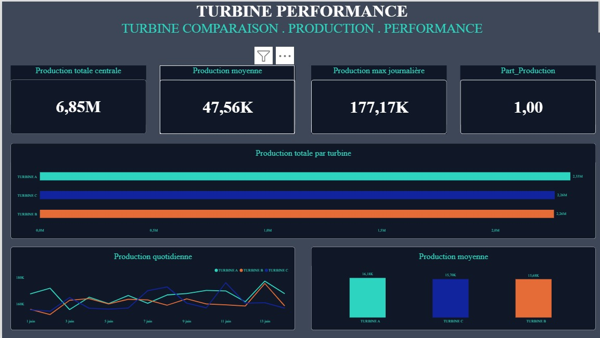
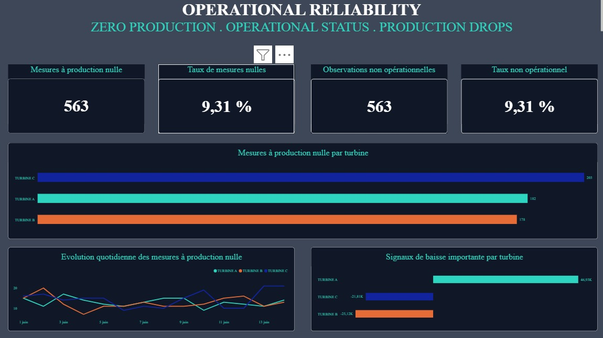

# Rapport Power BI

Le rapport présente les résultats de l’analyse à travers trois pages complémentaires.

## Executive Overview

Vue d’ensemble des indicateurs, filtres temporels et géographiques, et évolution quotidienne de la production.

## Turbine Performance

Comparaison des productions totales et moyennes entre les turbines, ainsi que leur évolution dans le temps.

## Operational Reliability

Suivi des mesures à production nulle, des statuts et des signaux de variation importante.

## Fichiers du rapport

Les fichiers du projet Power BI fournis sont organisés dans ce dossier, avec les captures des pages et les fichiers de définition disponibles. À l’ouverture dans Power BI Desktop, configurer la source PostgreSQL correspondant à l’environnement utilisé, puis actualiser les données.
